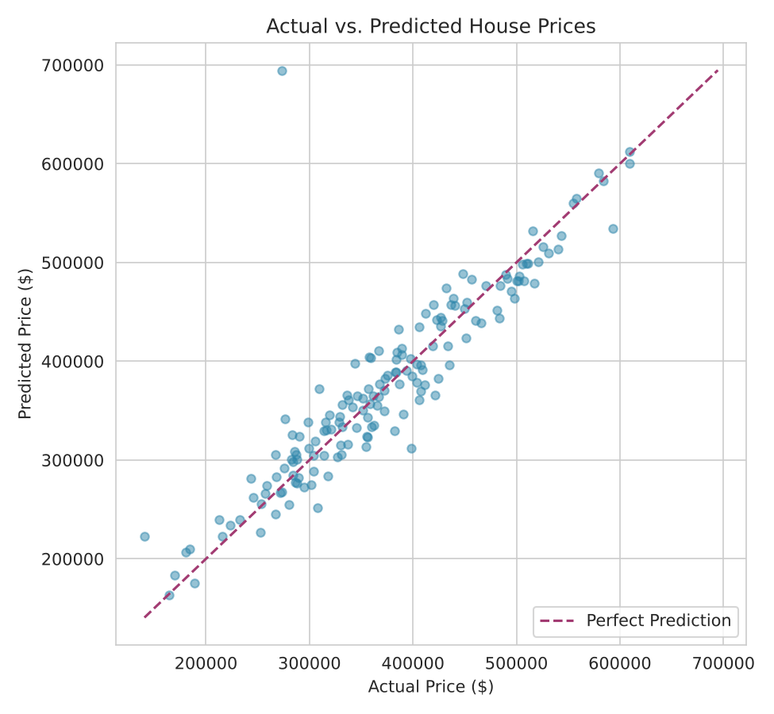
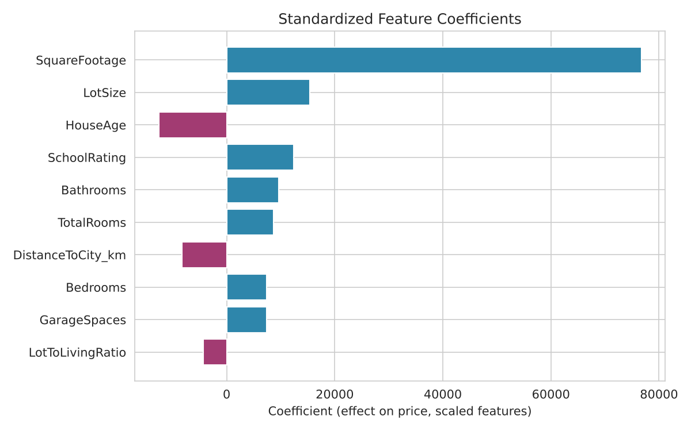
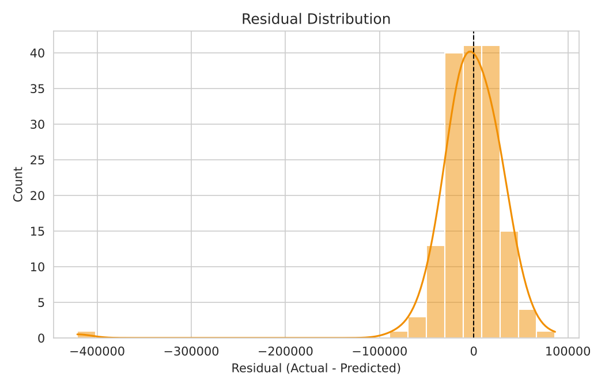

# House Price Prediction using Linear Regression

An end-to-end supervised machine learning pipeline that predicts house
sale prices from structured property data, with a focus on rigorous
preprocessing (missing values, outliers, feature engineering, scaling)
and transparent model evaluation.

## Overview

Given raw property records — square footage, bedrooms, lot size, age,
location, school ratings — this project builds a reproducible pipeline
that:

1. Cleans missing values and removes data-entry outliers
2. Engineers derived features that improve linear fit (house age,
   lot-to-living ratio, total rooms)
3. Splits into train/test (80/20)
4. Scales features (scaler fit on the training split only) so
   coefficients are comparable across variables of very different
   magnitude, and trains a linear regression model
5. Evaluates performance with **MSE**, **RMSE**, and **R²**
6. Visualizes predictions, residuals, and feature importance for
   interpretability

## Tech Stack

`Python` · `Pandas` · `NumPy` · `Scikit-learn` · `Matplotlib` · `Seaborn`

## Project Structure

```
house-price-prediction/
├── data/
│   └── housing_data.csv           # generated dataset
├── src/
│   ├── generate_data.py           # synthetic housing data generator
│   ├── preprocessing.py           # missing values, outliers, feature engineering, scaling
│   ├── modeling.py                # train/test split, model fit, MSE/R² evaluation
│   └── pipeline.py                # orchestrates the full run
├── notebooks/
│   └── analysis.ipynb             # exploratory, narrative version
├── results/                       # generated plots + CSV outputs
├── requirements.txt
└── README.md
```

## How to Run

```bash
git clone https://github.com/niki-kandlikar/house-price-prediction.git
cd house-price-prediction
pip install -r requirements.txt

python src/generate_data.py      # creates data/housing_data.csv
cd src
python pipeline.py               # runs the full pipeline, writes ../results/
```

## Methodology

**Missing value handling** — `Bathrooms`, `LotSize`, `SchoolRating`, and
`GarageSpaces` contain realistic missingness (2–5% of rows), imputed
with the column median to avoid distorting the distribution.

**Outlier removal** — rows with a z-score beyond 4 standard deviations
on `SquareFootage` (simulating data-entry errors) are dropped before
training.

**Feature engineering** — three derived features are added on top of
the raw fields:
- `HouseAge` (from `YearBuilt`)
- `LotToLivingRatio` — lot size divided by living square footage
- `TotalRooms` — bedrooms + bathrooms combined

**Feature scaling** — all features are standardized with
`StandardScaler`, fit on the training split only so test-set statistics
don't leak into training, so regression coefficients are
directly comparable in magnitude regardless of each feature's original
units.

**Evaluation** — the model is scored on a held-out 20% test split using:

| Metric | Value |
|---|---|
| R² | 0.807 |
| RMSE | ~$42,584 |
| MSE | ~1.81B |

One caveat: the data is synthetic (`generate_data.py`), so this R²
mostly reflects how much noise the generator adds, not how well a
linear model would do on real listings. The next step is rerunning this
on a real dataset (e.g. Ames Housing).

## Results

**Actual vs. predicted prices** — points near the dashed diagonal
indicate accurate predictions:



**Feature coefficients** — which features move price the most, holding
others constant (on standardized features, so magnitudes are
comparable):



Square footage is by far the strongest positive driver of price, followed
by lot size and school rating. House age and distance to city center
both push price down, as expected.

**Residual distribution** — roughly centered at zero with no strong
skew, suggesting the linear model isn't systematically over- or
under-predicting:



## Future Improvements

- Compare against regularized regression (Ridge/Lasso) to handle
  multicollinearity between engineered and raw features
- Try tree-based models (Random Forest, Gradient Boosting) to capture
  non-linear relationships
- Add neighborhood/location categorical features via one-hot or target
  encoding
- Cross-validation instead of a single train/test split for more
  robust performance estimates
- Run it on real data (Ames Housing) instead of the synthetic set
